<div align="center">


<br/>



</div>

---

### 🧭 About me

Software Engineering graduate from **Al-Hussein Bin Talal University**, based in the **UAE**.
Currently training in **networking and cybersecurity** (CCNA track) and heading towards a **SOC Analyst** role.
At night I build and ship real software, and I review each product for security before it goes out.

<table>
<tr>
<td width="50%" valign="top">

### 🛠️ Builder


Requirements · UML · ER modeling · Technical documentation

</td>
<td width="50%" valign="top">

### 🛡️ Defender


VLANs · IP addressing · Routing · IoT networks · Security reviews

</td>
</tr>
</table>

---

### 🚀 Featured work

<table>
<tr>
<td width="50%" valign="top">

**🩺 [ClinicFlow](https://github.com/yousefqawasmi599-sys/clinicflow-showcase)**
Clinic management and multi-clinic SaaS, Arabic and English.
`Laravel` `Filament` `2FA` `OWASP-reviewed`

</td>
<td width="50%" valign="top">

**💬 [ReplyFlow](https://github.com/yousefqawasmi599-sys/replyflow-showcase)**
AI receptionist for WhatsApp and websites, in Arabic dialects.
`Laravel` `Gemini / OpenAI / Claude` `OWASP-reviewed`

</td>
</tr>
<tr>
<td width="50%" valign="top">

**👕 [Y Store](https://github.com/yousefqawasmi599-sys/Y-STORE)**
Streetwear storefront with accounts, cart, checkout and admin.
`Next.js` `Supabase` `Row-level security`

</td>
<td width="50%" valign="top">

**📱 [TechStore](https://github.com/yousefqawasmi599-sys/TechStore)**
Arabic RTL phone store with cart, checkout and admin dashboard.
`PHP` `PDO` `MariaDB` `69 tests`

</td>
</tr>
<tr>
<td width="50%" valign="top">

**🧠 Memora** · *graduation capstone*
AI-assisted Alzheimer's MRI classification. I led the documentation of a five-person team (grade 91).
`Requirements` `ER design` `UML`

</td>
<td width="50%" valign="top">

**🏢 Smart Building Network** · *Packet Tracer*
Three-floor network with routers, switches, wireless and IoT devices.
`Routing` `Switching` `IoT`

</td>
</tr>
</table>

---

### 📡 Currently

```text
[■■■■■■□□□□] CCNA track      — Mostar IT training
[■■■□□□□□□□] Security+       — studying
[■■□□□□□□□□] TryHackMe       — SOC Level 1 path
[■■■■□□□□□□] FAHEEM          — classified 🤫
```

---

<div align="center">


### 📬 Let's connect

<a href="mailto:yousefqawasmi599@gmail.com"></a>
<a href="mailto:flowapps.support1@gmail.com"></a>
<a href="https://flowapps.gumroad.com"></a>


</div>

